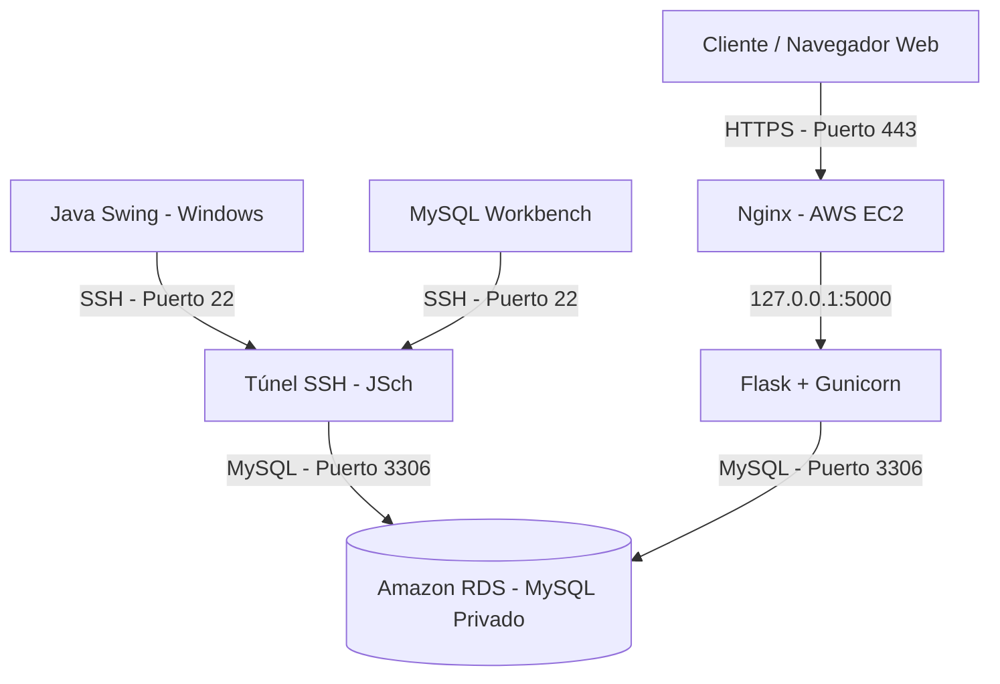

# ☕ VALLE CAFÉ
## Sistema Híbrido Multiplataforma en AWS

**Proyecto Práctico AP07 | Web + Desktop + Amazon RDS Privado**

Valle Café es un sistema híbrido multiplataforma desarrollado para gestionar clientes y pedidos de una cafetería mediante dos aplicaciones independientes que comparten una única base de datos relacional alojada en Amazon RDS.

El proyecto integra una aplicación web desarrollada con Python Flask, desplegada en AWS EC2, y una aplicación de escritorio implementada con Java Swing, JDBC y JSch.

Ambas aplicaciones permiten realizar operaciones CRUD sobre la misma base de datos MySQL, proporcionando interoperabilidad entre plataformas y comunicación segura mediante un túnel SSH.

Adicionalmente, la aplicación web incorpora HTTPS mediante Nginx y Let's Encrypt.

---

## 📌 Información del proyecto

| Campo | Descripción |
|---|---|
| Proyecto | Valle Café |
| Actividad | S16 - AP07 |
| Tipo | Sistema híbrido multiplataforma |
| Infraestructura | Amazon Web Services |
| Aplicación web | Python Flask |
| Aplicación de escritorio | Java Swing |
| Base de datos | MySQL Amazon RDS |
| Comunicación segura | SSH + JSch |
| Acceso a datos | JDBC |
| Servidor web | Nginx |
| Servidor de aplicaciones | Gunicorn |
| Seguridad HTTPS | Let's Encrypt + Certbot |
| Sistema operativo EC2 | Ubuntu 24.04 LTS |

---

## 🎯 Objetivo general

Desarrollar e implementar un sistema híbrido multiplataforma en AWS que permita gestionar clientes y pedidos de una cafetería desde aplicaciones web y de escritorio, utilizando una base de datos relacional privada y mecanismos seguros de comunicación.

### Objetivos específicos

- Implementar una aplicación web con Python Flask.
- Desarrollar una aplicación de escritorio con Java Swing.
- Configurar una instancia AWS EC2 para desplegar Flask.
- Implementar una base de datos MySQL privada en Amazon RDS.
- Establecer un túnel SSH programático utilizando JSch.
- Implementar operaciones CRUD desde ambas aplicaciones.
- Garantizar la sincronización de información entre plataformas.
- Aplicar el principio de menor privilegio en MySQL.
- Configurar Security Groups para restringir conexiones.
- Implementar HTTPS mediante Nginx y Let's Encrypt.
- Ejecutar pruebas de interoperabilidad y seguridad.

---

## 🏗️ Arquitectura del sistema

La solución utiliza una arquitectura híbrida que integra recursos locales y servicios en la nube.

### Diagrama de arquitectura



### Descripción de la arquitectura

**Cliente Web**

Los usuarios acceden a Valle Café mediante un navegador utilizando HTTPS.

**AWS EC2**

La instancia EC2 aloja Flask, Gunicorn y Nginx.

**Nginx**

Recibe las conexiones HTTPS y redirige las solicitudes hacia Gunicorn.

**Gunicorn**

Ejecuta Flask mediante el puerto interno `127.0.0.1:5000`.

**Amazon RDS**

Almacena los clientes y pedidos en una base de datos MySQL privada.

**Java Swing**

Permite administrar pedidos desde una computadora Windows.

**JSch**

Establece un túnel SSH programático hacia AWS EC2.

**JDBC**

Permite realizar las operaciones de base de datos desde Java.

---

## 🛠️ Tecnologías utilizadas

### Aplicación web

- Python
- Flask
- HTML5
- CSS3
- JavaScript
- Gunicorn

### Aplicación de escritorio

- Java 17
- Java Swing
- Maven
- JDBC
- JSch

### Base de datos

- MySQL
- Amazon RDS
- MySQL Workbench

### Infraestructura AWS

- Amazon EC2
- Amazon RDS
- Amazon VPC
- AWS Security Groups
- Ubuntu Server 24.04 LTS

### Seguridad

- SSH
- HTTPS
- TLS
- Nginx
- Let's Encrypt
- Certbot
- Usuarios MySQL con privilegios limitados

---

## 📁 Estructura del proyecto

```text
valle-cafe-ap07/
│
├── .github/
│
├── database/
│   ├── schema.sql
│   ├── usuarios.example.sql
│   └── datos_prueba.sql
│
├── deploy/
│   └── valle-cafe.service.example
│
├── desktop/
│   ├── src/
│   │   └── main/
│   │       └── java/
│   │           └── pe/
│   │               └── edu/
│   │                   └── vallegrande/
│   │                       └── cafe/
│   │                           └── CafeDesktop.java
│   │
│   ├── config.properties.example
│   └── pom.xml
│
├── docs/
│   ├── ACTUALIZACION_ADMIN.md
│   ├── GUIA_DESPLIEGUE.md
│   └── INFORME_Y_VIDEO.md
│
├── web/
│   ├── static/
│   │   ├── admin.css
│   │   ├── admin.js
│   │   ├── store.css
│   │   ├── store.js
│   │   └── style.css
│   │
│   ├── templates/
│   │   ├── admin.html
│   │   └── index.html
│   │
│   ├── tests/
│   │   └── test_formulario.py
│   │
│   ├── .env.example
│   ├── app.py
│   └── requirements.txt
│
├── .gitignore
└── README.md
```

---

## 🗄️ Base de datos

El sistema utiliza una única base de datos MySQL alojada en Amazon RDS.

**Nombre del esquema:**

```sql
valle_cafe
```

### Tabla clientes

Almacena la información de los clientes registrados.

| Campo | Tipo | Descripción |
|---|---|---|
| id | INT | Identificador del cliente |
| nombre | VARCHAR(100) | Nombre completo |
| telefono | VARCHAR(25) | Número telefónico |
| correo | VARCHAR(120) | Correo electrónico |
| creado_en | TIMESTAMP | Fecha de registro |

### Tabla pedidos

Almacena los pedidos realizados.

| Campo | Tipo | Descripción |
|---|---|---|
| id | INT | Identificador del pedido |
| cliente_id | INT | Identificador del cliente |
| producto | VARCHAR(100) | Producto solicitado |
| cantidad | INT | Cantidad solicitada |
| precio_unitario | DECIMAL(10,2) | Precio unitario |
| estado | ENUM | Estado del pedido |
| creado_en | TIMESTAMP | Fecha de registro |

### Relación entre tablas

La relación se establece mediante:

```sql
pedidos.cliente_id → clientes.id
```

Esta relación permite asociar cada pedido con su cliente correspondiente.

### Estados disponibles

- Pendiente
- Preparando
- Listo
- Entregado

### Script de creación

El esquema se encuentra disponible en:

```text
database/schema.sql
```

---

## 🔐 Seguridad de Amazon RDS

La instancia de Amazon RDS se encuentra configurada con:

```text
Acceso público: No
```

Esto impide establecer conexiones directas desde Internet hacia la base de datos.

La comunicación con MySQL se realiza mediante recursos autorizados dentro de AWS.

### Usuarios MySQL

Se implementaron dos usuarios independientes:

```text
valle_app_web
valle_app_desktop
```

### Usuario web

Utilizado por Flask para consultar y modificar la información.

### Usuario desktop

Utilizado por Java Swing mediante JDBC y un túnel SSH.

Ambos usuarios tienen únicamente los siguientes permisos:

```sql
SELECT
INSERT
UPDATE
DELETE
```

Los permisos se encuentran limitados al esquema:

```sql
valle_cafe.*
```

No se concedieron privilegios administrativos como:

```sql
CREATE
ALTER
DROP
GRANT OPTION
```

De esta manera, se aplica el principio de menor privilegio.

---

## 🌐 Aplicación web Flask

La aplicación web está desarrollada con Python Flask y desplegada en AWS EC2.

Dispone de dos interfaces principales.

### Tienda pública

La tienda permite:

- Visualizar productos.
- Explorar el menú.
- Filtrar bebidas por categorías.
- Agregar productos al carrito.
- Registrar pedidos.
- Consultar el estado de los pedidos.

### Panel administrativo

El panel administrativo permite:

- Registrar pedidos.
- Consultar pedidos existentes.
- Modificar información.
- Eliminar pedidos.
- Registrar clientes.
- Consultar clientes.
- Filtrar pedidos por estado.
- Buscar pedidos por cliente o producto.
- Visualizar estadísticas generales.

### Dirección de la aplicación

**Tienda pública:**

https://18.209.63.184

**Panel administrativo:**

https://18.209.63.184/admin

> La IP pública puede cambiar si la instancia EC2 se detiene y vuelve a iniciarse sin una Elastic IP.

---

## 🖥️ Aplicación de escritorio Java Swing

La aplicación Java permite administrar los pedidos registrados en Amazon RDS mediante una interfaz gráfica.

### Funcionalidades

- Conexión mediante túnel SSH.
- Conexión JDBC a MySQL.
- Registro de pedidos.
- Consulta de registros.
- Actualización de pedidos.
- Eliminación de registros.
- Actualización de la tabla.
- Selección de clientes.
- Administración de estados.

### Conectividad

La aplicación utiliza JSch para establecer automáticamente un túnel SSH hacia EC2.

El flujo de conexión es:

```text
Java Swing
    ↓
JSch
    ↓
Túnel SSH hacia EC2
    ↓
Amazon RDS privado
    ↓
MySQL
```

JDBC utiliza el puerto local configurado para acceder a MySQL mediante el túnel.

La aplicación debe cerrar las conexiones JDBC y SSH al finalizar su ejecución.

---

## 🔒 Implementación de HTTPS

Como mejora adicional, Valle Café incorpora HTTPS utilizando Nginx y Let's Encrypt.

### Funcionamiento

```text
Navegador
    ↓
HTTPS - Puerto 443
    ↓
Nginx
    ↓
HTTP interno - 127.0.0.1:5000
    ↓
Flask + Gunicorn
    ↓
MySQL AWS RDS
```

Nginx recibe las conexiones HTTPS y las envía internamente hacia Gunicorn.

### Certificado SSL

El certificado fue generado mediante Let's Encrypt directamente para la dirección IP pública de EC2.

No fue necesario contratar un dominio.

Se utilizó el perfil:

```text
shortlived
```

### Renovación automática

La renovación del certificado se encuentra configurada mediante Certbot.

Se utiliza el método `webroot`, que permite validar el servidor mientras Nginx continúa funcionando.

Además, se configuró un `deploy-hook` para recargar Nginx después de renovar el certificado.

### Comprobar la renovación

```bash
sudo /snap/bin/certbot renew --dry-run
```

La simulación se completó correctamente.

> Los certificados de Let's Encrypt para direcciones IP tienen una duración aproximada de seis días. Por ello, es importante mantener activa la renovación automática.

---

## ☁️ Configuración de AWS EC2

La aplicación se encuentra desplegada en una instancia EC2 con Ubuntu 24.04 LTS.

### Servicios utilizados

- Flask
- Gunicorn
- Nginx
- Certbot
- SSH

### Verificar Gunicorn

```bash
sudo systemctl status valle-cafe --no-pager
```

### Verificar Nginx

```bash
sudo systemctl status nginx --no-pager
```

### Verificar el puerto interno

```bash
sudo ss -ltnp | grep 5000
```

Resultado esperado:

```text
127.0.0.1:5000
```

Esta configuración impide que Gunicorn escuche directamente en las interfaces públicas de EC2.

---

## 🛡️ Security Groups

Los Security Groups permiten controlar las conexiones de entrada y salida de los recursos AWS.

### Security Group de EC2

| Puerto | Protocolo | Función |
|---|---|---|
| 22 | TCP | Acceso SSH |
| 80 | TCP | Redirección HTTP y validación SSL |
| 443 | TCP | Acceso HTTPS |

El puerto `5000` es utilizado internamente por Gunicorn y no necesita estar expuesto públicamente.

Se recomienda restringir SSH a las direcciones IP autorizadas.

### Security Group de RDS

| Puerto | Protocolo | Origen |
|---|---|---|
| 3306 | TCP | Security Group de EC2 |

La base de datos no requiere una regla pública para el puerto 3306.

---

## ⚙️ Instalación y configuración

### 1. Clonar el repositorio

```bash
git clone https://github.com/Alejandro-Oswaldo-d-Jesus-Soto-Cardenas/valle-cafe-ap07.git
```

Ingresar al proyecto:

```bash
cd valle-cafe-ap07
```

### 2. Preparar Flask

```bash
cd web
```

Crear el entorno virtual:

```bash
python3 -m venv .venv
```

Activar el entorno:

```bash
source .venv/bin/activate
```

Instalar dependencias:

```bash
pip install -r requirements.txt
```

### 3. Configurar las variables de entorno

Crear una copia del archivo de ejemplo:

```bash
cp .env.example .env
```

Editar `.env` con los datos correspondientes al entorno local o AWS.

No publicar este archivo en GitHub.

### 4. Preparar Java Swing

Desde la carpeta `desktop` en Windows:

```powershell
Copy-Item config.properties.example config.properties
```

Editar `config.properties` con:

- Dirección IP de EC2.
- Usuario SSH.
- Ruta de la clave privada.
- Endpoint privado de RDS.
- Puerto local del túnel.
- Usuario MySQL correspondiente.

### 5. Ejecutar Java

```powershell
mvn clean compile exec:java
```

---

## 🔄 Interoperabilidad entre aplicaciones

La aplicación web y la aplicación de escritorio utilizan una única base de datos compartida.

Esto permite que los registros creados o modificados desde una plataforma puedan visualizarse desde la otra.

### Ejemplo de funcionamiento

**1. Registro desde Flask**

Se registra un pedido en la aplicación web.

**2. Consulta desde Java**

Al actualizar la tabla de Java Swing, aparece el pedido registrado.

**3. Modificación desde Java**

Se modifica la cantidad, precio o estado del pedido.

**4. Verificación desde Flask**

Al actualizar el panel administrativo, se visualizan los cambios.

**5. Eliminación**

Se elimina un registro de prueba y se verifica que desaparezca de ambas aplicaciones.

---

## 🧪 Pruebas de integración

El plan de pruebas incluye las siguientes operaciones:

| Código | Prueba | Resultado esperado |
|---|---|---|
| P01 | INSERT Web → Java | Registro visible en Java |
| P02 | INSERT Web → Workbench | Registro visible en MySQL |
| P03 | UPDATE Java → Web | Cambio visible en Flask |
| P04 | INSERT Java → Web | Nuevo registro visible |
| P05 | UPDATE Web → Java | Cambio visible en Java |
| P06 | DELETE Web → Java | Registro eliminado |
| P07 | Conexión directa a RDS | Conexión rechazada |
| P08 | DROP TABLE sin permisos | Access denied |
| P09 | Revisión de .gitignore | Credenciales excluidas |
| P10 | HTTPS | Conexión segura |
| P11 | Renovación SSL | Simulación satisfactoria |

Las pruebas deben documentarse mediante capturas reales y sus resultados.

---

## 🔍 Pruebas de seguridad

### 1. Conexión directa a RDS

Se intenta establecer una conexión desde MySQL Workbench hacia el endpoint privado de Amazon RDS sin utilizar un túnel SSH.

Resultado esperado:

```text
Connection timed out
```

### 2. Restricción de privilegios MySQL

Se utiliza el usuario de escritorio para intentar ejecutar una operación DDL no permitida sobre una tabla de prueba inexistente.

Resultado esperado:

```text
Access denied
```

### 3. Protección de credenciales

El archivo `.gitignore` excluye:

```gitignore
.env
**/.env
**/config.properties
*.pem
*.key
**/venv/
**/.venv/
**/__pycache__/
**/.pytest_cache/
**/target/
.idea/
.vscode/
*.log
*.sql.bak
```

No se deben publicar:

- Contraseñas de MySQL.
- Claves privadas SSH.
- Credenciales AWS.
- Archivos `.env` reales.
- Archivos `config.properties` reales.

Los archivos `.example` contienen únicamente valores de referencia.

---

## 📊 Resultados obtenidos

Durante las primeras pruebas de integración se comprobó la visualización de registros compartidos entre la aplicación web y Java Swing.

Se registraron cuatro pedidos utilizados para la demostración inicial.

Entre ellos se encuentran:

- Latte Vainilla.
- Cappuccino clásico.
- Mocha de chocolate.
- Americano clásico.

El valor acumulado de los cuatro pedidos iniciales fue de:

**S/ 63.50**

La información fue visualizada desde ambas aplicaciones, confirmando que utilizan la misma base de datos MySQL alojada en Amazon RDS.

Las pruebas finales CRUD y de seguridad deben documentarse con sus respectivas evidencias.

---

## 📚 Documentación

El repositorio incluye documentación complementaria:

```text
docs/ACTUALIZACION_ADMIN.md
docs/GUIA_DESPLIEGUE.md
docs/INFORME_Y_VIDEO.md
```

La documentación contempla:

- Despliegue en AWS.
- Configuración de la base de datos.
- Conectividad mediante SSH.
- Pruebas de integración.
- Seguridad.
- Informe técnico.
- Video de demostración.

---

## 🎥 Video de demostración

Como parte de la entrega académica se preparará un video de entre cinco y ocho minutos.

La demostración incluirá:

1. Presentación de Valle Café.
2. Arquitectura implementada.
3. Configuración de AWS EC2 y RDS.
4. Ejecución de la aplicación web.
5. Ejecución de Java Swing.
6. Registro de pedidos.
7. Actualización cruzada de información.
8. Eliminación de registros.
9. Pruebas de seguridad.
10. Conclusiones.

**Enlace al video:** Pendiente de agregar.

---

## 📄 Informe técnico

El informe técnico incluirá:

- Introducción.
- Objetivos.
- Arquitectura AWS.
- Configuración de Security Groups.
- Modelo de datos.
- Implementación web.
- Implementación de escritorio.
- Pruebas CRUD.
- Pruebas de seguridad.
- Resultados.
- Conclusiones.

**Enlace al informe:** Pendiente de agregar.

---

## 👨‍💻 Equipo de desarrollo

**Proyecto académico:** S16 | AP07

**Integrante:**

Alejandro Oswaldo de Jesús Soto Cárdenas

**Otros integrantes:**

- [Nombre completo]
- [Nombre completo]
- [Nombre completo]

**Docente:**

Ebert Bernardo Ocares Luna

---

## ✅ Conclusiones

Valle Café demuestra la integración de aplicaciones web y de escritorio mediante una arquitectura híbrida implementada en Amazon Web Services.

La utilización de Amazon RDS permite centralizar la información y mantener una base de datos compartida entre Flask y Java Swing.

La implementación del túnel SSH mediante JSch permite establecer conexiones desde una computadora local hacia una base de datos privada, sin habilitar su acceso público.

Asimismo, la aplicación de políticas de menor privilegio, Security Groups, HTTPS y Nginx contribuye a reforzar la seguridad del sistema.

El proyecto permite aplicar conocimientos de desarrollo multiplataforma, infraestructura en la nube, bases de datos relacionales y conectividad segura.

---

## 🔗 Enlaces importantes

**Repositorio GitHub:**

https://github.com/Alejandro-Oswaldo-d-Jesus-Soto-Cardenas/valle-cafe-ap07

**Aplicación web:**

https://18.209.63.184

**Panel administrativo:**

https://18.209.63.184/admin

**AWS:**

https://aws.amazon.com/

**Documentación Flask:**

https://flask.palletsprojects.com/

**Documentación Let's Encrypt:**

https://letsencrypt.org/

---

**VALLE CAFÉ — Proyecto Práctico AP07**

Sistema híbrido multiplataforma con Flask, Java Swing y Amazon RDS privado.