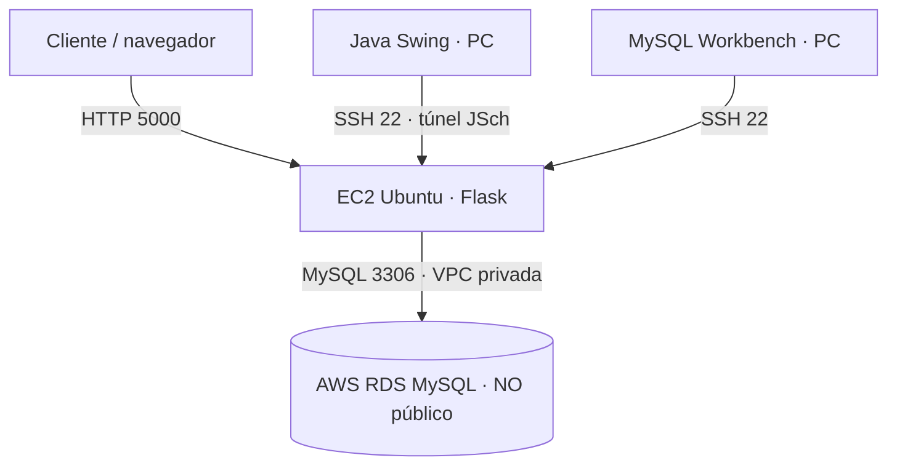

# VALLE CAFÉ — Sistema híbrido AWS (AP07)

**Proyecto nuevo** de cafetería premium con marca original: tienda web pública Flask, panel privado para gestionar pedidos, aplicación Java Swing y base de datos única MySQL RDS privada. Diseño inspirado en el estilo de cafeterías modernas, sin usar logos ni identidad de Starbucks.

## Arquitectura



> Para producción usar HTTPS y una API para el cliente de escritorio. HTTP:5000 y el túnel son para la práctica de laboratorio AP07.

## Contenido

| Ruta | Contenido |
|---|---|
| `database/schema.sql` | Base `valle_cafe`, `clientes` y `pedidos` con FK |
| `database/usuarios.example.sql` | SQL de creación de usuarios de mínimo privilegio |
| `database/datos_prueba.sql` | Datos ficticios de demostración (ejecutar una sola vez) |
| `web/` | Tienda pública con carta, filtros, carrito y seguimiento; panel privado en `/admin`; Flask, estilos, JS, pruebas y `.env.example` |
| `desktop/` | Maven Java 17, Swing, JSch, JDBC, `config.properties.example` |
| `deploy/valle-cafe.service.example` | Servicio systemd para EC2 |
| `docs/GUIA_DESPLIEGUE.md` | Instalación, SG, túnel y pruebas cruzadas |
| `docs/INFORME_Y_VIDEO.md` | Modelo de informe y guion de 5–8 min |

## Configuración resumida

1. Crear EC2 Ubuntu y MySQL RDS **con acceso público desactivado**, ambos en la misma VPC.
2. Restringir Security Groups como se detalla en [la guía](docs/GUIA_DESPLIEGUE.md).
3. Desde EC2 como administrador MySQL ejecutar `database/schema.sql` y crear `app_web`/`app_desktop` con las contraseñas elegidas.
4. En EC2 instalar Python y dependencias, completar `web/.env` con `app_web`, `ADMIN_USER` y `ADMIN_PASSWORD`, y ejecutar Flask con Gunicorn en puerto 5000.
5. En PC copiar `desktop/config.properties.example` como `desktop/config.properties`; ingresar IP EC2, endpoint RDS, ruta `.pem` y `known_hosts`. Ejecutar desde `desktop/` con `mvn clean compile exec:java`.
6. Crear un pedido desde Java y actualizar la página web; editar desde Flask (`/admin`) y pulsar **Actualizar lista** en Java. Confirmar ambos en Workbench. Desde la tienda pública se pueden registrar pedidos del menú en el carrito.

### Rutas públicas y administración

- `/`: cafetería pública, carta, categorías, carrito y consulta del estado por correo y teléfono.
- `POST /api/pedidos`: crea o reutiliza cliente y registra pedidos; el **precio se calcula en el servidor** según el menú.
- `GET /api/seguimiento`: estado de pedidos asociados al correo y teléfono indicados.
- `/admin`: panel administrativo previo, con CRUD completo sobre pedidos. **Requiere** `ADMIN_USER` y `ADMIN_PASSWORD` en el archivo privado `.env`.

**Seguridad:** La autenticación básica de `/admin` es solo para el laboratorio. No publicar el panel por HTTP sin TLS: para un despliegue abierto al público, configurar HTTPS, sesiones y protección CSRF, además de controles antiabuso para los formularios públicos. El pedido en línea no cobra dinero: es un registro de pedido de demostración.

**Importante:** El repositorio no debe incluir claves PEM, credenciales, dumps con datos reales, archivos `.env` ni `config.properties`. Los archivos de ejemplo contienen únicamente valores ficticios. No reutilizar `config.properties` ni credenciales del AP06.

## Pruebas sin AWS

```bash
cd web
python -m pip install -r requirements.txt
python -m unittest discover -s tests -v
```

```powershell
cd desktop
mvn clean compile
```

Las pruebas funcionales completas requieren la EC2 y el RDS configurados (no están incluidos ni se crean automáticamente al compilar).
